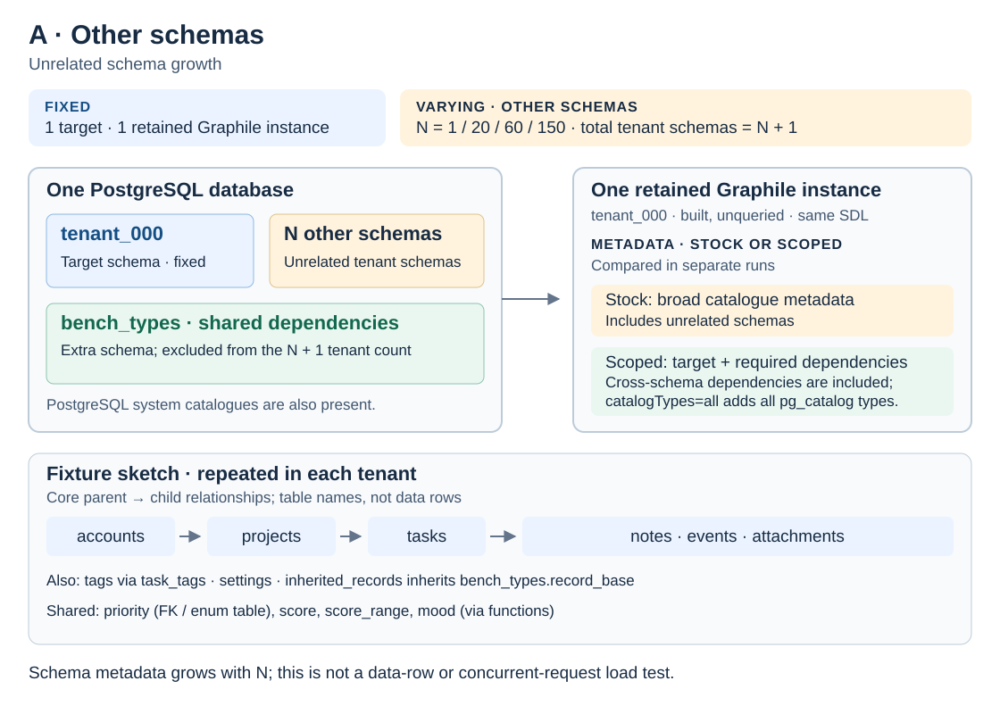
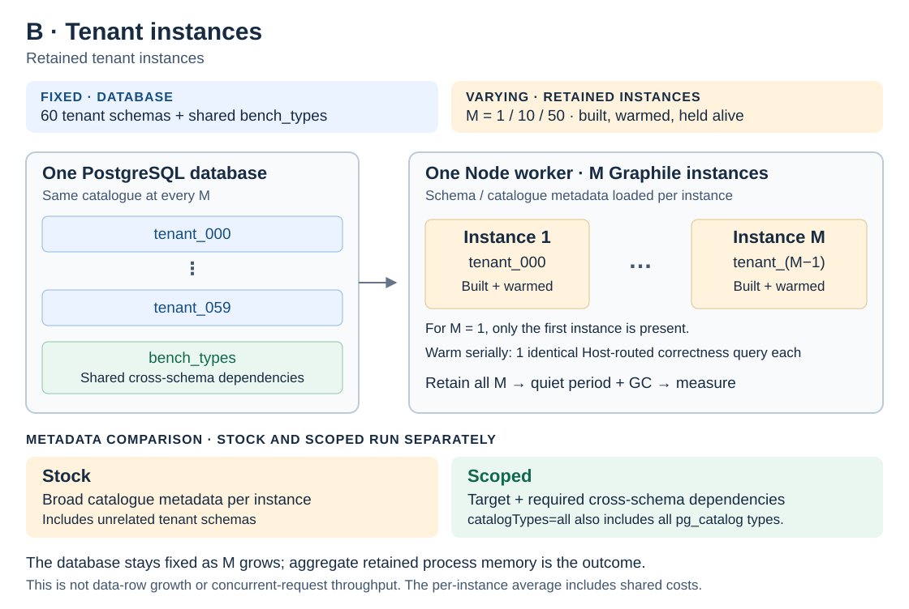

# Graphile multitenant memory benchmark

**Scoped retained less JavaScript heap in these synthetic runs, with usually
slower schema builds.** With 150 other schemas and one retained target, median
incremental heap fell from **58.28 MiB to 3.92 MiB (93.28%)**. With 50 retained
tenant instances, it fell from **1244.02 MiB to 195.26 MiB (84.30%)**. Scoped's
median build time was higher at six of seven points. Three repetitions per point
describe this workload; they do not establish production latency or general
correctness.

The 93.28% reduction applies only to **incremental heap above baseline**. At the
same 150-other-schema point, total retained heap fell from 87.29 MiB to 33.03 MiB
(62.16%), and process RSS fell from 329.76 MiB to 115.54 MiB (64.96%). These are
different memory measures, defined below.

This private, standalone benchmark compares published PostGraphile **Stock**
(`BENCH_PROFILE=stock`) with **Scoped** (`BENCH_PROFILE=local-scoped`), this
repository's attributed PR2 adaptation. Stock uses the original Amber
introspection plugin. Scoped replaces only that plugin, with `catalogTypes=all`
and no capability extensions, reusing the same published parser, catalogue types
and package graph. A fresh clone installs registry dependencies and builds
locally; no Crystal checkout is needed.

Choose a reading path:

- **Understand the result:** the [comparison report](results/COMPARISON.md#conclusion) has
  memory tables, their interpretation, build timings and limitations.
- **Reproduce or regenerate:** the [reproduction note](results/REPRODUCTION.md)
  separates fresh measurements from regenerating the report using existing data.
- **Audit the evidence:** start with the report's
  [run identity](results/COMPARISON.md#verified-run-identity) and
  [42 raw measurements](results/COMPARISON.md#raw-measurements), then inspect the
  [verification receipt](results/comparison-verification.json) and
  [exact metrics](results/local-metrics.json).

The current result tree contains only the A/B comparison and its raw evidence.
Earlier runs remain in
[Git history](https://github.com/Zetazzz/graphile-multitenant-memory-repro/tree/20cd35cb7561aa679718be85c79db001038231c3/results).

These measurements were collected at
[`b9aa76d`](https://github.com/Zetazzz/graphile-multitenant-memory-repro/tree/b9aa76d027d35e14e00a648cf219025df39f1c5d),
before the local source directories moved under `plugins/`. Recorded paths and
source/build hashes preserve that measured layout. The 42 raw samples retain their
original values; report wording can be regenerated without new measurements.

## Install and run

Requires Node 24+, pnpm 11.19.0 and Docker Compose. PostgreSQL 17.7 is pinned in
`compose.yaml`, bound to loopback port 55432, with `max_locks_per_transaction=512`.
The database and example password are synthetic and dedicated to this benchmark.

```sh
pnpm install --frozen-lockfile
pnpm typecheck
pnpm build
pnpm format:check
pnpm db:up
NODE_ENV=production GRAPHILE_ENV=production pnpm test
pnpm db:fixture 2
pnpm start
```

```sh
curl http://127.0.0.1:5678/graphql \
  -H 'Host: tenant_000.localhost' -H 'x-bench-user: 1' \
  -H 'Content-Type: application/json' \
  --data '{"query":"{ requestIdentity allTasks { nodes { title ownerId } } }"}'
```

`x-bench-user` supplies synthetic test identity, not authentication. The loopback
server applies tenant/user settings inside each transaction; RLS filters both
values. Hosts must match the tenant allowlist. The database guard permits only the
loopback `graphile_memory_bench` database as `bench_admin`; do not use a business
database. `BENCH_PG_PORT` changes the Compose host port/default connection string;
`BENCH_DATABASE_URL` permits the same guarded database on a local PostgreSQL
installation. `pnpm db:down` preserves its benchmark volume.

## Focused comparison

`bench:memory` runs only these seven points, three fresh workers per point:

| Scenario                      | Fixed                                                           | Varies                                                          | Purpose                                                                     |
| ----------------------------- | --------------------------------------------------------------- | --------------------------------------------------------------- | --------------------------------------------------------------------------- |
| A — Unrelated schema growth   | One built, unqueried target instance                            | Other schemas: N = 1, 20, 60, 150; N + 1 tenants in the fixture | Isolate how unrelated catalogue growth affects one target's retained memory |
| B — Retained tenant instances | A 60-tenant fixture and the same correctness query per instance | Tenant instances: M = 1, 10, 50 held simultaneously             | Measure aggregate retained memory as more tenant instances stay alive       |

In A, each other schema is an unrelated synthetic tenant schema; the target's SDL
stays identical across all points and profiles. In B, incremental heap includes
shared runtime costs, so dividing by M is an average per instance, not an exclusive
object-ownership measurement. A/B and N/M remain the machine identifiers; raw
fields such as `scenario`, `value`, `totalTenants` and `loadedInstances` are unchanged.



*A — Other schemas.* The database contains `tenant_000`, N unrelated tenant
schemas and the shared `bench_types` schema. Only one built, unqueried Graphile
instance is retained as N varies.



*B — Tenant instances.* The database stays at 60 tenant schemas plus `bench_types`.
Each of the M retained Graphile instances is warmed once with the same Host-routed
correctness query.

The diagrams show catalogue metadata and retained instances, not data-row growth
or concurrent request load. Stock gathers broad catalogue metadata; Scoped focuses
on the target and required cross-schema dependencies. The measured
`catalogTypes=all` setting also includes all `pg_catalog` types.

Two profiles produce **42 samples total**. Each worker first discards a separate
five-request warmup instance, awaits its release and collects the baseline. The
runner keeps the same 5.5-second quiet periods, three forced GCs at each memory
stage, separate client processes and awaited release. This comparison measures
only A/B retention and release; it does not measure rotation, operation-cache
growth or heap-snapshot ownership.

### Read the memory measures

- **Incremental heap:** retained JavaScript `heapUsed` minus the same worker's
  post-warmup baseline `heapUsed`, calculated before taking the three-worker
  median. It includes shared runtime costs and is the basis of the 93.28% claim.
- **Total heap:** the whole process's retained-stage JavaScript `heapUsed`,
  including its baseline. This is used heap, not V8's `heapTotal` capacity.
- **RSS:** resident memory for the entire process, including JavaScript heap,
  native allocations and allocator overhead. Peak RSS also includes discarded
  warmup; a high RSS after release alone does not establish a JavaScript leak.

These measures cover the server's Node worker, excluding the separate HTTP client
and PostgreSQL processes. The report uses MiB (2^20 bytes), computes each percentage
against Stock, and shows Scoped minus Stock deltas. Memory savings and build costs
must be read together: Scoped's median build was slower at every measured point
except A with 150 other schemas. The samples are serial and unpaired across
profiles; three repetitions are insufficient for confidence intervals or broad
performance guarantees.

Use new run names when measuring again; raw workers and preflight receipts refuse
to overwrite existing evidence. Commit source changes before preflight. With a
built, clean source tree and the database running:

```sh
BENCH_PROFILE=stock pnpm preflight stock-next
BENCH_PROFILE=local-scoped pnpm preflight local-next
BENCH_PROFILE=stock BENCH_RUN=stock-next pnpm bench:memory
BENCH_PROFILE=local-scoped BENCH_RUN=local-next pnpm bench:memory
pnpm verify-results stock-next --matrix memory
pnpm verify-results local-next --matrix memory
pnpm report stock-next local-next results
```

Tests, fixture resets and benchmarks must run serially. Regenerate the checked-in
report without measuring again using `pnpm report stock local-scoped results`.
`compare:local` is an alias for the same comparison generator. Verification checks
exact point/repetition counts, independent PIDs, clean source, matching build and
dependency provenance, profile activation, released instances and invariant A SDL.
Preflight records the correctness tests before measurement.

### What correctness checks cover

Both measured profiles passed their recorded correctness preflights. Coverage is
grounded in these synthetic tests:

- [HTTP integration](test/integration.test.ts) checks concurrent tenant/user RLS
  isolation, transaction-local settings, hidden cross-schema types and inheritance,
  rejected hosts/users, operation-plan growth and replay, DDL/NOTIFY rebuilding,
  and release waiting for SQL after a client abort.
- [Lifecycle tests](test/core.test.ts) check coalesced builds, active leases,
  awaited asynchronous release, failed-build recovery and the database guard.
- [Scoped integration](test/scoped-integration.test.ts) compares SDL hashes and
  the `__typename` result, and checks dependency metadata for types, functions,
  foreign keys, inheritance, indexes and extensions, plus a missing-root failure.
  These additional tests use `catalogTypes=dependency-closure` and `pg_trgm`
  capability extensions; the measured Scoped profile uses `catalogTypes=all`
  without capability extensions. They do not claim full query equivalence.
- [Query validation](test/scoped-introspection.test.ts),
  [service configuration](test/scoped-service.test.ts),
  [activation](test/activation.test.ts), and
  [report verification](test/local-comparison.test.ts) check parameterization,
  rejected configurations and missing dependencies, the shared package graph,
  aggregation and provenance rejection.

This coverage does not establish correctness for every PostgreSQL schema,
extension or application workload. Cache and lifecycle checks are correctness
tests, not long-running memory measurements. The A/B results do not establish
indefinite memory bounds, automatic-GC latency, request latency or exclusive object
ownership. See the [reproduction note](results/REPRODUCTION.md) for the recorded
environment and timing limitations.

## Implementation

All maintained implementation, CLIs and tests are TypeScript, compiled with strict
NodeNext/ES2023 settings. Local source is typechecked; external declarations use
`skipLibCheck`. Runtime dependencies remain `postgraphile`, `pg` and `express`.
No CNC code, dependencies, production data or application logic is included.

- `src/runtime/`: Amber instances, Host routing, request leases, serialized LRU
  changes and NOTIFY invalidation. Active requests keep their instance alive until
  their leases finish; eviction awaits release.
- `src/fixture/`: guarded synthetic tenants, RLS and hidden cross-schema dependencies.
- `src/benchmark/` and `src/measurement/`: scenario selection, isolated workers,
  unchanged collection protocol, source/build provenance and optional diagnostics.
- `src/report/`: raw-result validation and the reproducible comparison.
- `plugins/graphile-build/graphile-build-pg/` and `plugins/utils/pg-introspection/`:
  attributed local PR2 sources. [UPSTREAM.md](UPSTREAM.md) records adaptations,
  licences and pinned refs.
- `test/`: lifecycle, concurrency, RLS, release, invalidation, cache, scoped query,
  service configuration, package identity and reporting checks. Tests use synthetic
  fixtures and do not require previous measurement files.

Run `pnpm build` after changing source. Commands use emitted `dist/` files; build
receipts hash source, tests, local candidate files, configuration and emitted code.
Workers reject stale builds. Stock does not load the local candidate; both profiles
share the same registry package identities. `BENCH_PROFILE` selects only `stock`
or `local-scoped` and is incompatible with an active external-checkout link.

After DDL, `NOTIFY bench_schema_changed, 'tenant_000'` invalidates the affected
exposed tenant. Hidden shared-type changes require notifying each affected tenant;
automatic dependency discovery is outside this reproduction.

## Optional checkout and diagnostic tools

The focused comparison above does not use an external checkout. `crystal:link`
and `crystal:stock` retain the optional Stock/common-base/PR2 workflow. Build an
upstream Crystal checkout first, then link it with
`pnpm crystal:link /absolute/path/to/crystal common-base` (or `pr2`), test it, and
restore with `pnpm crystal:stock`. The switch changes only the local package
symlink and records the checkout SHA and resolved dependency paths. It does not
edit registry packages or the dependency lock.

PR3 shares PR2's scoped algorithm and is not separately benchmarked.

`bench:a`, `bench:b`, `bench:c`, `bench:d` and `bench:all` remain optional diagnostic
commands; `bench:b` also includes rotation, whereas `bench:memory` selects A and B
only. `report:run <run>` can report an explicitly requested diagnostic run.
`compare <common-base-run> <pr2-run> <output-directory>` verifies the pinned checkout
comparison using each run's own preflight receipt. None of these commands requires
old results to exist in the current tree.
